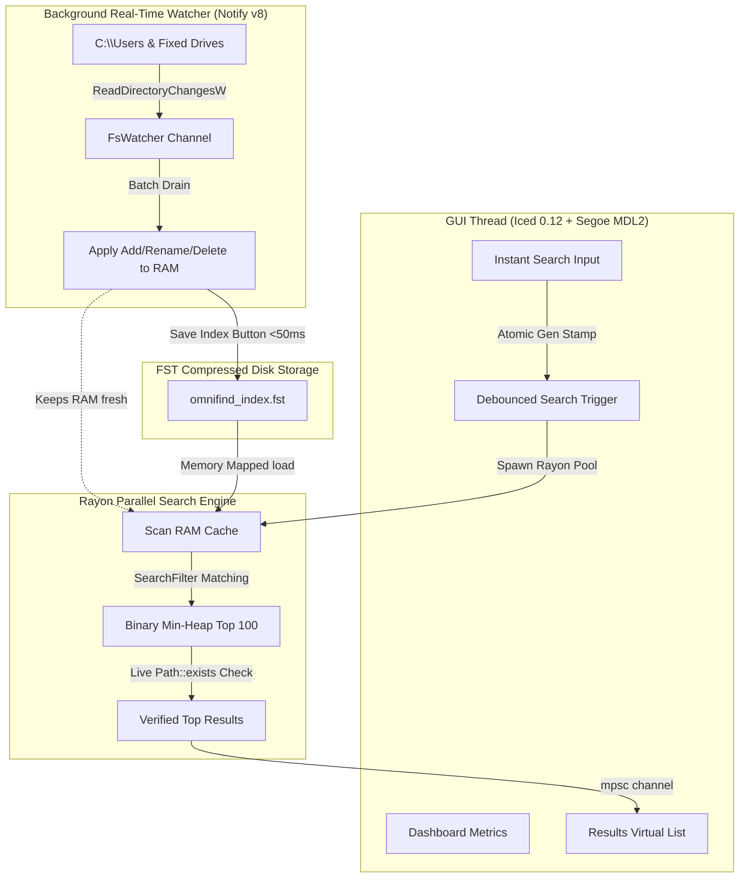

<div align="center">

# ⚡ OmniFind

**Lightning-Fast Desktop File Search Engine for Windows**

*Search through millions of files in microseconds with Google-style search dorks, real-time filesystem synchronization, and a modern Windows 11 Fluent Light dashboard.*

[](https://github.com/waleed-tahir/omnifind)
[](https://www.rust-lang.org)
[](LICENSE)

</div>

---

## 🚀 Overview

**OmniFind** is an ultra-high performance desktop file search application engineered in Rust. By maintaining an in-memory sorted cache coupled with parallel Rayon scans and an atomic generation-counter search pipeline, OmniFind delivers query results in under **1 millisecond** across 1.4+ million indexed filesystem paths.

Unlike conventional file indexers that continuously churn disks and spike CPU usage, OmniFind relies on real-time OS-level filesystem notifications across all connected Windows drives, updating its in-memory index instantaneously when files are created, modified, renamed, or deleted.

---

## ✨ Features

- **⚡ Instant Sub-Millisecond Search**: Queries 1,400,000+ files in memory in ~150–500 microseconds with zero keystroke lag.
- **🔄 Live Filesystem Watcher**: Listens for kernel filesystem events across `C:\Users` and all non-system data drives (`D:\`, `E:\`, etc.) using `notify` v8, applying additions, renames, and recursive folder deletions in real time.
- **🔍 Advanced Google Search Dorks**:
  - `ext:pdf`, `filetype:docx`, `ext:png,jpg`, `*.rs`, `.toml` (Extensions)
  - `name:report`, `filename:invoice`, `intitle:readme` (Filename only)
  - `path:finance`, `dir:projects`, `folder:rust` (Path substring)
  - `drive:c`, `site:d:` (Specific drive filter)
  - `-draft`, `-path:node_modules`, `-ext:tmp` (Exclusion / NOT)
  - `"quarterly report 2024"` (Exact phrase matching)
  - `cat OR dog`, `ext:png OR ext:jpg` (Boolean OR branching)
- **📋 Windows Clipboard Integration**: Multi-select results with checkboxes and perform native Windows Shell Copy / Cut (`CF_HDROP`) directly into Windows Explorer.
- **📁 Explorer Reveal**: Open any file's containing folder with the target file automatically selected and scrolled into view via native Windows `SHOpenFolderAndSelectItems` COM API.
- **🎨 Windows 11 Fluent Light UI**: Built using `iced 0.12` and styled after modern Windows 11 Light Dashboard design language, powered by the pre-installed Windows `Segoe MDL2 Assets` UI kit.
- **🛡️ 100% Non-Blocking Architecture**: Background indexing threads run at `THREAD_PRIORITY_BELOW_NORMAL` so Windows never flags the GUI as "Not Responding" even during multi-terabyte disk scans.
- **💾 Dual Persistence Modes**: Seamlessly operates in `%LOCALAPPDATA%\OmniFind\omnifind_index.fst` or in Zero-Config Portable Mode via local `omnifind_index.fst`.

---

## 🔎 Search Syntax & Dorks Guide

OmniFind supports composable search filters that can be combined in any order:

| Operator | Syntax Example | Description |
|---|---|---|
| **File Extension** | `ext:pdf`, `*.rs`, `ext:png,jpg` | Matches files with the specified extension(s). |
| **Filename Only** | `name:report`, `filename:invoice` | Matches only against the file's basename (ignoring parent directories). |
| **Path / Folder** | `path:documents`, `dir:projects` | Matches against the full parent directory path. |
| **Drive Letter** | `drive:c`, `drive:d` | Restricts search to a specific Windows drive. |
| **Negation / NOT** | `-draft`, `-path:node_modules` | Excludes any result matching the given term or filter. |
| **Exact Phrase** | `"quarterly budget 2024"` | Matches the exact sequence of words inside quotes. |
| **Boolean OR** | `invoice OR receipt`, `*.png OR *.jpg` | Matches either condition. |

### Practical Examples
```text
budget 2024 ext:xlsx,csv path:finance -draft
project intitle:readme drive:d
"design system" ext:fig,svg -path:node_modules
```

---

## 🏗️ Architecture



---

## 🛠️ Building from Source

### Prerequisites
- **Operating System**: Windows 10 or Windows 11 (64-bit)
- **Rust Toolchain**: Rust 1.80+ (Edition 2024 compatible)
- **Windows SDK**: Pre-installed on Windows 10/11 (for `rc.exe` resource compilation)

### Build Steps

```powershell
# Clone the repository
git clone https://github.com/waleed-tahir/omnifind.git
cd omnifind

# Run unit test suite
cargo test

# Build optimized release binary with embedded Windows icon
cargo build --release
```

The optimized release executable will be produced at:
```text
target/release/omnifind.exe
```

---

## 📄 License

This project is licensed under the [MIT License](LICENSE) — authored by [Waleed Tahir](https://github.com/waleed-tahir).
